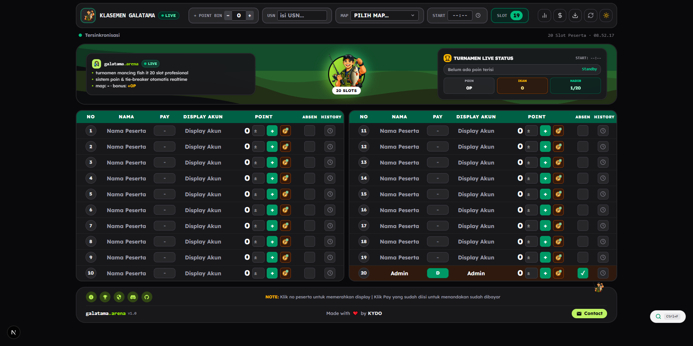

<p align="center">
  
</p>

<div align="center">

# KLASEMEN GALATAMA

### Live Tournament Leaderboard Platform

A modern, minimalist, and high-performance tournament leaderboard platform designed for Roblox *Fish It* Galatama fishing competitions. Built with Next.js 16 (Turbopack), React 19, TypeScript, and Tailwind CSS, featuring automated real-time scoring, tie-breaker ranking logic, payment management, and aesthetics inspired by **Google Material Design 3**.

[](https://nextjs.org/)
[](https://react.dev/)
[](https://www.typescriptlang.org/)
[](https://tailwindcss.com/)
[](LICENSE)

<br />
<br />

<p align="center">
  
</p>

</div>

---

## Features

- [x] **20-Slot Live Leaderboard**: 2-column layout (Slots 1–10 on the left, 11–20 on the right) with auto-proportional scaling to fit any screen size without vertical scrollbars.
- [x] **Automated Ranking & Tie-Breaker**: Sorts by total points, with secondary tie-breakers based on earliest caught timestamp and visual tie-group highlights for Top 10 contenders.
- [x] **"Tarik Ikan" Scoring Popup**: Official fish species and point weights (Secret, Big, Shiny, Pelagon, Megalodon, Glacial, FB Maxton, Forgotten, etc.) with real-time log history.
- [x] **Automatic BIN Bonus Synchronization**: Auto-adds configurable `+ POINT BIN` bonus when `bin` is entered in the participant's Pay column.
- [x] **Payment & Attendance Tracking**: 1-click Pay toggle for paid status (`D`), double-click to edit custom amounts, and attendance checkmarks.
- [x] **Penalties & Warning Red Display**: Click any participant slot number (`NO`) to toggle the row's warning red highlight.
- [x] **Admin Revenue & Analytics**: Modals for calculating grand total pay, collected payments, unpaid slots, and tournament statistics.
- [x] **Floating Quick Search (Ctrl+F)**: Search participants instantly by slot, name, or account display name.
- [x] **Material 3 Aesthetics**: Wavy striped canvas backdrop, center pop-out angler mascot sticker, and interactive footer with tournament guide.
- [x] **Dark / Black Mode by Default**: Tailored dark theme with smooth toggle to light mode and persistent `localStorage` preference.
- [x] **Data Export & Backup**: Export tournament state to CSV (Excel-ready) or JSON backup.

---

## Inspiration & Ideas

This project builds upon the excellent work of several open-source projects:
- **[ihsanalfarizi/Klasemen_Galatamaa](https://github.com/ihsanalfarizi/Klasemen_Galatamaa)** - The original concept, game mechanics, and tournament rules reference for the Galatama fishing leaderboard.

---

## Prerequisites

- **Node.js**: Version 18.18 or higher (LTS recommended)
- **Package Manager**: npm, yarn, or bun

---

## Installation & Development

1. Clone the repository:
```bash
git clone https://github.com/88JC/Klasemen-Galatama.git
cd Klasemen-Galatama
```

2. Install dependencies:
```bash
npm install
# or
yarn install
# or
bun install
```

3. Run the development server:
```bash
npm run dev
# or
yarn dev
# or
bun dev
```

4. Open your browser at [http://localhost:3000](http://localhost:3000)

---

## Building for Production

Compile and optimize the project for production deployment:
```bash
npm run build
npm start
```

---

## Deployment

Optimized for seamless deployment on Vercel:

[](https://vercel.com/new/clone?repository-url=https%3A%2F%2Fgithub.com%2F88JC%2FKlasemen-Galatama)

---

## Contributing

Contributions, bug reports, and feature requests are welcome! Feel free to check the [issues page](https://github.com/88JC/Klasemen-Galatama/issues) or submit a pull request.

---

## License

This project is open-sourced under the [MIT License](LICENSE).